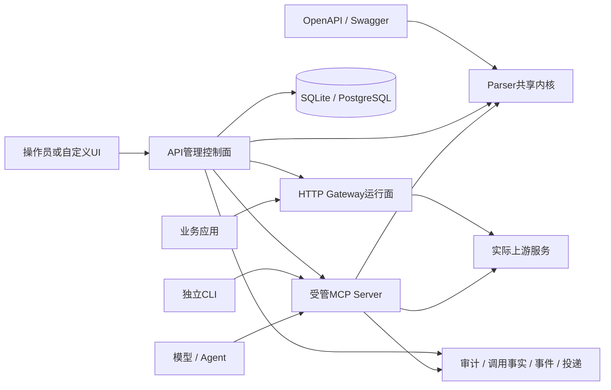

# 总体设计与功能架构

本文是项目当前总体设计入口；能力和验收状态分别以[项目概览](../overview/PRODUCT.md)、[统一台账](../guides/active-work-package-execution-status.md)为准。历史设计中的拟实施项不作为当前功能承诺。

## 分层与依赖

| 层 | 工作区 | 职责与边界 |
| --- | --- | --- |
| Parser共享内核 | api-nova-parser | OpenAPI/Swagger解析、校验、规范化、操作提取与共享执行/安全/审计原语 |
| Server运行时 | api-nova-server | MCP工具装配、协议传输与运行；依赖Parser，受管方式还接受API交付的可信上下文 |
| API控制面及Gateway | api-nova-api | 资产、测试、治理、发布、持久化、管理认证、受管进程、HTTP Gateway和可观测性 |
| UI展示与操作 | api-nova-ui | Vue操作界面，通过HTTP API与Socket.IO读取和操作；不直接读数据库或持有Server进程管理权 |

Gateway在API进程内承接HTTP转发；MCP可以独立CLI运行，也可以由API管理子进程。API进程中的MCP管理模块不等于已经启动了所有MCP监听。

## 功能模块

- **规范与目录**：openapi、asset-catalog，统一登记源资产及端点。
- **实例与测试**：source-service-instances、endpoint-testing，分开保存实际地址、测试用例、运行和样例。
- **治理与发布**：publication、runtime-governance、runtime-upstream-bindings、runtime-verification，以当前证据构造候选并验证激活。
- **运行面**：runtime-assets、servers、gateway-runtime，管理成员装配、进程、路由和消费凭据。
- **安全与运维**：security、config、health、monitoring、websocket、call-observability，处理权限、有效配置、健康、调用与投递。
- **辅助模块**：documents、ai-assistant等现有控制器列入[API清单](../api/ENDPOINTS.md)；模块存在不代表外部模型、密钥或第三方服务已配置。

模块装配以[AppModule源码](../../packages/api-nova-api/src/app.module.ts)为准。

## 数据模型与发布链路

源服务资产表达逻辑API身份；端点定义表达方法、路径及语义；运行实例保存可变化的真实服务位置；运行资产是面向消费者的Gateway/MCP身份。成员关系把端点纳入运行资产，成员上游绑定选择实际运行实例。逻辑资产不能因实例A下线就被删除或误建为B资产。

测试证据、治理状态、成员配置、凭据和revision共同约束发布候选。候选重放成功才按已有门禁激活；失败保留旧版本。上游或绑定变化使已有验证失效，不能继续把旧证据当作当前可发布证明。详见[发布与样例合同](../reference/publication-contract.md)。

## 安全与观察平面

管理JWT、运行时消费凭据和上游认证是三种不同身份。控制面做角色/权限/资源范围检查；运行面按自身凭据、工具/路由范围及撤销状态检查；上游秘密只在获准的执行边界解析。详见[安全合同](../reference/security-contract.md)。

可观测性以调用事实、物理上游尝试及各类来源为基础，经持久化、投影、事件、Outbox和投递形成链路。管理心跳和本进程路由注册仅说明各自观察范围，不证明跨节点业务存活。详见[可观测性运维](../guides/OBSERVABILITY.md)。

## 部署与UI替换

开发时UI9000、API9001、独立MCP9022分进程运行；离线包由API9001托管构建后的静态UI，MCP运行实例仍是独立运行面。UI9000不是离线包必须启动的第二个Web服务。

应用可以直接调用管理API和运行面，使用自己的UI。需要实现登录/刷新、权限和资源范围、注册到发布的状态流程、错误/游标及可选Socket.IO协议；不是直接替换数据库表单。当前没有独立UI发行物，默认前端使用相对`/api`及`/socket.io`；分域部署需配置代理/CORS。见[开发接入](../development/DEVELOPER_GUIDE.md#自定义ui与系统接入)。

SQLite适用于一个API实例和持久可写卷；PostgreSQL提供另一条既有持久路径，实际多进程/目标容量仍按对应证据核验。当前双库基线为73张业务表、每种方言8项迁移，自动同步关闭。详见[数据库](../guides/database-strategy.md)。
