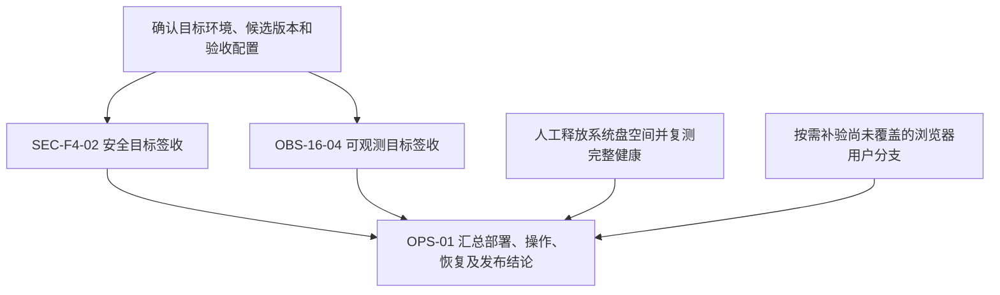

# ApiNova 开发审查与后续线程交接（2026-10-14）

> 2026-10-14后续进展：本机带绝对server URL的OpenAPI浏览器导入分支19/19、同构建手工注册回归19/19已通过；修复治理页缺少运行实例入口，40项UI专项及构建通过。见[OpenAPI导入浏览器证据](../audits/2026-10-14-ops-browser-openapi-import.md)及更新后的执行台账。下文保留原交接快照，原“浏览器导入未覆盖”现仅适用于本次限定范围之外的分支；SEC/OBS/OPS生产签收仍待办。

> 2026-10-14后续用户调整：磁盘门槛改为至少空闲5GiB，已完成真实API+MCP完整health200及8项健康回归，见[5GiB门槛与健康复验](../audits/2026-10-14-health-free-space-policy.md)。本文旧90%规则及先释放2GiB的要求被本次明确授权替代；生产签收边界保持不变。

## 1. 交接结论与阅读顺序

当前已具备注册、测试治理、Gateway/MCP发布消费、安全控制、二进制留存及可观测的主要工程能力，并有各自限定环境的验收证据。**当前剩余主线是3项目标签收任务，不是3个仍待从零开发的大功能包；另外有2项明确延期需求。生产签收尚未完成。** 本机通过、子项DONE和生产可用是不同结论。

本次审查核对了工作树、近期提交、远端分支、209条任务及245条依赖、任务划分/台账/未完成事项、专题历史记录、近期审计和本机原始证据。仅更新文档，没有重新运行产品功能测试、压力测试或生产验收；下列测试数字均注明所属既有验证，不能相加当作本轮全量测试。本文件是截至本日的交接快照，后续进展以更新后的台账为准。

后续线程按以下顺序阅读：

1. 本文：基线、剩余工作、依赖、交接操作。
2. [工作包总览与执行状态](./active-work-package-execution-status.md)：当前状态的唯一调度入口。
3. [工作包划分](./active-work-package-breakdown.md)：原任务合同和依赖；[未完成事项](../reference/open-items.md)：范围边界。
4. [阶段规划](./staged-development-plan.md)和对应审计：解释能力、历史决策与证据。

专题安全/可观测文档中的2026-09阶段计数和“当前未完成”描述保留用于历史追溯，不能覆盖上述台账或重新生成待开发队列。原安全/正确性合同仍有效；时间门禁按用户后续调整执行。

## 2. 仓库与可恢复基线

| 项目 | 复核结果 |
| --- | --- |
| 工作目录 | `E:\CodexDev\api-nova`，Windows PowerShell |
| 当前工作分支 | `oc_dev`；不要按早期聊天中的main快照切换分支或合并 |
| 远端 | `https://github.com/joe-ieta/api-nova.git`，`origin/oc_dev` |
| 本次文档修改前代码基线 | `23d0bcc3a670907976f310384ca4109dbbae3d86`；已确认本地HEAD与远端一致 |
| 工作树 | 文档修改前受跟踪文件干净；无待恢复的受跟踪半成品 |
| 未跟踪文件 | `.tmp/`、`h11a-api-full.log`、`h11a-regression.log`、`h11b-matrix.log`、`h11b-regression.log`；不要批量提交 |
| 项目组织 | npm workspaces：`api-nova-api`、`api-nova-parser`、`api-nova-server`、`api-nova-ui` |
| 最近浏览器验收环境 | Windows、Node v24.15.0、隔离SQLite、打包UI、Headless Edge 155.0.4283.45；不是支持所有版本的声明 |

本次交接文档提交会在上述代码基线上增加一个文档提交；用`git log`确认实际交接HEAD。既有验收脚本已记录工作树和构建哈希：浏览器证据的commit字段为当时的`60bf65f`，包含后来提交为`23d0bcc`的工作树修复；压力证据的commit字段为`da15e67`，包含后来提交为`60bf65f`的改动。不能仅凭证据中的父提交字段称为最终HEAD的重新全量验收。

## 3. 已完成能力及近期工作

| 能力/近期提交 | 已完成与可复用证据 | 不应外推的范围 |
| --- | --- | --- |
| 注册→治理→Gateway消费，EXT-01～05 | Windows真实HTTP 11阶段闭环；导入、无server绑定、手工注册、认证聚合、A→B迁移及撤销；94套/1312项回归。[审计](../audits/2026-10-08-ext-01-05-gateway-lifecycle.md) | 该HTTP验证不等于所有浏览器页面、目标环境和角色已验 |
| 二进制留存，PROD-04C | 本机PG/真实HTTP16项，15套/237项；采集、授权读取、到期/撤销、清理、重启恢复。[审计](../audits/2026-10-08-prod-04c-binary-lifecycle.md) | 目标账户ACL、Linux文件语义、MCP二进制真实外发仍需目标矩阵 |
| MCP、安全装配、许可与撤销 | F3、F1、EXT-06～09等已有SDK/Streamable/SSE、受管进程、网络合同与撤销的限定证据，复用台账链接 | 默认关闭能力必须实际配置；局部验证不能写成已部署 |
| Linux补充，EXT-09 | Ubuntu容器同版本安装、三包构建、迁移和受管Streamable流程已有证据 | 未证明裸机/systemd、该组合PG/UI、长期负载及生产部署 |
| 重复Gateway部署 | 同candidateRevision激活冲突已修，真实PG/HTTP17项。[审计](../audits/2026-10-08-gateway-repeat-deployment.md) | 不代表多主机并发首次激活的完整CAS保证 |
| 本机健康/监控，ENV-01 | MCP失联汇总错误已修；打包和Vite监控HTTP入口共8项；按“完整通过或限制有证据”合同关闭。[审计](../audits/2026-10-08-env-01-health-and-monitoring.md) | 完整health仍有磁盘限制，不能称全绿 |
| `da15e67`：SSE安全补丁及指标批写 | 官方SSE修复回移；正常/注入HTTP、干净安装和发布布局6项；构建/打包/启动检查实际字节。[审计](../audits/2026-10-08-security-nest-sse-backport.md) | 本地修复不等于维护大版本迁移或目标安全签收 |
| `60bf65f`：采集/投递工程闭环 | 双库43组、API186套/1940项、流水线114项、本地查询故障94项和修正后的重启3项；PG3000功能全量通过。[审计](../audits/2026-10-08-observability-functional-closure.md) | SQLite3000未全量；不能将曾失败的组合运行描述为全部通过；时间仅诊断 |
| `23d0bcc`：打包UI Gateway浏览器闭环 | 19/19阶段、无未捕获浏览器错误；注册→探测/测试治理→smoke样本→Registry v1→绑定/发布/部署→UI凭证→401/200真实消费→同请求监控刷新。UI回归38/38、2150条文案编译及UI构建通过。[审计](../audits/2026-10-14-ops-browser-workflow.md) | 该轮未重跑完整API回归；未覆盖浏览器OpenAPI导入、A/B迁移、MCP、多角色及目标生产环境 |
| 邮件、分块、国际化 | MAIL-01/02、MAINT-01/02已限定交付；受控邮件6套/30例等成果可复用 | 真实SMTP/第三方接收、长期邮件队列和生产告警不能由受控sink证明 |

`23d0bcc`修复了四处实际阻塞：Registry v1显式配置入口、生产JSON文案编译、发布成员的源实例标识、草稿成员被默认ready过滤隐藏。它不是纯测试补充。实例健康探测仍是部署前置条件，不能以绕过409探测拒绝来“通过”部署。

近期提交序列`84c7aaf → 5a9f227 → 5f5e2d2 → 1c2c58c → da15e67 → 60bf65f`多次处理持久化、指标、采集、投递和压力收敛。它们有真实产出，但不是独立完成多个产品功能包的等价物。

## 4. 所有正式未关闭任务

机器核对结果：**209个历史叶子，204 DONE、2 IN_PROGRESS、1 WAIT_DEP、2 DEFERRED，245条依赖；无缺失ID、重复ID、依赖环或DONE先于未完成依赖。** 不以204/209计算“产品完成率”：叶子大小不等，最终交付还需要环境与人员签收。

| 原任务 | 状态/依赖 | 未完成工作与下一步 | 关闭所需证据 |
| --- | --- | --- | --- |
| SEC-F4-02 | IN_PROGRESS；已列工程前置均DONE；可与OBS并行 | 核定目标OS/架构/DB、运行账户ACL、真实身份/角色、凭据注入、TLS/代理/出站策略、实际启用能力；复核依赖公告与残余风险处置。Nest维护版本迁移未完成，见下一节 | 同一候选在目标安全矩阵中有结果；例外/未覆盖项有明确处置与责任人；本地SSE修复不能代替签收 |
| OBS-16-04 | IN_PROGRESS；本机工程与限定专项DONE；可与SEC并行 | 目标collector/outbox/delivery/GC与留存开关、目录ACL、DB/拓扑、受控告警接收端、备份恢复/回退与容量合同核验 | 目标配置、数据及投递正确性、保留/恢复与回退证据齐备；时间目标仅记录；未证明的SQLite容量不能承诺 |
| OPS-01 | WAIT_DEP；直接依赖SEC-F4-02和OBS-16-04 | 本机Gateway浏览器主线已验；以同候选执行目标安装启动/重启、完整健康、权限/TLS、告警与回退，汇总发布结论 | 可复现安装和回退说明、两项前置签收、必要操作和健康证据、发布/不发布结论；本机通过不能关闭生产签收 |
| DEFER-01 | DEFERRED；本里程碑不执行 | OAuth2，恢复时单独批准里程碑；当前不开发获取Token路径 | 新范围与出口批准后再排期；不挂到现有收口任务 |
| DEFER-02 | DEFERRED；本里程碑不执行 | 额外令牌适配与跨协议QoS | 新范围重新批准后推进；不扩入现有鉴权/观测 |

## 5. 未完成、未覆盖及维护事项的完整归属

下表是上面任务的具体出口或证据边界，**不新增任务ID、不重复计算工作包**。

| 事项 | 分类与归属 | 当前事实及后续动作 |
| --- | --- | --- |
| 目标/生产环境尚未指定 | 共同外部前置；SEC/OBS/OPS | 用户已决定暂用本机隔离环境、生产签收待办。不得用本地结果虚构目标部署；有环境后按第6节执行 |
| 完整health磁盘限制 | 本机已解除；OPS，ENV-01保持DONE | 用户于10-14改为至少空闲5GiB；本机可用约9GiB，完整health已实测200。旧90%样本保留历史，详见[5GiB门槛与健康复验](../audits/2026-10-14-health-free-space-policy.md)；目标环境仍另行签收 |
| 浏览器导入、A/B迁移、MCP、多角色 | 本机覆盖缺口；OPS | 现有HTTP/SDK证据继续有效。无目标环境时可选一条完整用户分支做有界补验；19阶段Gateway结果不证明这些分支，不把补验变成重写已完成能力 |
| 二进制目标ACL/Linux/MCP真实外发 | 环境/协议覆盖；SEC/OPS | 在目标矩阵列为未覆盖，针对实际支持组合补验；不重新开发采集/存储原语 |
| 实际SMTP、告警Webhook、证书/反代/出站 | 外部配置与验收；SEC/OBS/OPS | 受控sink和本地TLS结果可复用；需明确归属接收端和秘密注入方式，在受控范围下测试。不得外发到未指定第三方 |
| Nest维护迁移/残余依赖风险 | 维护剩余；SEC-F4-02 | 官方SSE回移已修实际路径；10-08审计的10 moderate版本节点、0 high/critical是历史结果，本次未运行新npm audit。后续先更新审计再决定维护迁移或记录风险处置，不能通过撤销补丁/忽略门禁使安装变绿 |
| 独立API workspace安装 | 安装覆盖；SEC/OPS | 脱离根manifest/lock的安装未保证。按根锁文件`npm ci`安装；若交付要求独立workspace，单独验证实际安装和补丁字节 |
| SQLite3000采集/投递未全量 | 非阻断诊断；OBS | 3000响应和源终态完整，30分钟观察1799终态/1615对应投递；关停后1943完成/1057待采集、1617投递成功/246待发，未见死信/隔离且数据库完整。不能称全量通过；不因本机耗时继续无期限优化 |
| 参考硬件、采集A/B、持续负载、多主机水位/真实业务存活 | 性能诊断或未覆盖承诺；OBS/OPS按原合同 | 局部管理状态不是业务存活证明；按实际部署合同核验，不自动扩为无限压测/跨主机工程 |
| 6个历史lint错误 | 维护基线；触及相关代码或成为实际门禁时处理 | [MAINT-01审计](../audits/2026-09-28-maint-01-frontend-chunking.md)记录既有6项，无新增；本次未重新检查，不称现版本lint通过，也不把它们新增为未实现功能 |
| 发布产物/tag/正式发布 | 签收后的交付动作；OPS | 当前源码推送不等于发布；实际发布时使用`api-nova-release`技能及发布标准，记录候选、产物哈希和环境结论。本次不创建发布 |
| 完整跨进程/多主机首次激活CAS | 未批准强化范围 | [PROD-06范围核定](../audits/2026-09-26-prod-06-cas-scope-determination.md)已单独裁定；重复部署修复不证明该保证，不自行开工 |

旧专题文档曾列“全局快照/配额/留存/旧consumer未完成”，其工程细项须按当前209条台账和后续审计复核，不能把旧段落逐条重新立项。仍缺的实际环境、长时和多主机证据按本节边界保留，不把所有历史TODO都视作本轮欠账。

## 6. 后续推进顺序、并发依赖和人工要求

浏览器补验按目标支持范围决定，不是将所有未覆盖项无条件升级为发布硬门禁。SEC与OBS可并行执行；使用独立测试数据库/端口/接收端，冻结同一候选代码和配置基线。OPS准备工作可先做，最终签收依赖两条线。不要一条线修改全局环境或共享构建目录，另一条线继续把结果算到旧候选。

需要部署负责人提供的资料：环境名称与用途、OS/架构、数据库版本和拓扑、运行账号和目录ACL、秘密注入方式（不贴密码/Token）、TLS/反向代理和出站网络策略、受控告警/SMTP接收端、批准的开关及留存配置、备份目标/恢复窗口/RPO/RTO、签收与风险处置责任人。

**目前继续遵守“本机隔离、生产待办”的选择，不反复索取环境或重复授权。** 若下一线程仍没有目标环境，应明确仅能补齐本机有界覆盖与可复用签收资料，完成后报告外部等待；不能为了保持工作量重做已完成能力、追加时间优化或将生产任务改DONE。

## 7. 后续线程操作手册

1. 进入仓库，读取本文及当前台账；运行`git status --short`、`git branch --show-current`、`git log -8 --oneline`、`git remote get-url origin`。有网络时用`git ls-remote origin refs/heads/oc_dev`核对远端，先保护其他人的改动，不自动reset或清理未跟踪证据。
2. 根据第4～6节选择一个明确的交付出口，并写清已覆盖、未覆盖和完成条件。需要目标环境的部分保持待办；修复仅围绕实际阻塞。
3. 复用现有脚本。先读脚本的构建、浏览器、PG/Docker和平台要求；它们多为本机隔离验收器，不能直接当作目标部署签收器。新克隆的`.tmp`不存在时重新生成所需证据，不能仅依赖本机绝对路径。
4. 有源码改动才执行受影响的专项与必要构建/回归；不要为文档变更重跑全部长测。证据须记录提交+工作树、产物哈希、环境/开关、功能结果、未覆盖项、退出码、资源清理和脱敏日志。
5. 同步台账、任务划分、未完成事项、审计及`docs/VERSIONS.md`。仅关闭有证据支持的出口；不新增细叶来制造完成数量。
6. 每个完成的工作包按已有授权提交并推送`origin/oc_dev`，核对远端提交；不提交`.tmp`、凭据或历史日志，不自动切换main，不自动发布。

可复用入口（按需要选择，不是每轮必须全跑）：

| 目的 | 根目录命令 | 主要前置/限制 |
| --- | --- | --- |
| SSE实际安装与发布布局 | `npm run verify:security-nest-sse` | 根锁文件依赖与vendor归档；可能运行隔离安装，阅读脚本 |
| Gateway HTTP主线 | `npm run verify:ext-01-05` | 已构建包，本机隔离上游 |
| 打包UI Gateway操作 | `npm run verify:ops-01-browser` | 已构建API/UI、Playwright与浏览器；默认打包UI，`--vite`仅诊断分支 |
| 健康及监控 | `npm run verify:env-01 -- --with-monitoring` | 当前Windows脚本与已构建运行时；完整health和磁盘结果如实报告 |
| 二进制联合验收 | `npm run verify:prod-04c` | 阅读脚本配置隔离PG/目录，不能借用生产库 |
| TLS信任、PG冷备恢复 | `npm run verify:obs-16-04-tls-trust`、`npm run verify:obs-16-04-backup-restore` | 本机受控证书/接收端、PG工具与隔离目录；既有2/2、7/7可复用 |
| OBS本机专项/环境矩阵 | `npm run verify:obs-16-local-unit`、`npm run verify:obs-16-03` | 按脚本核对所需DB/容器及平台；不是生产已签收 |
| 压力诊断 | `npm run verify:obs-16-04-performance` | 仅在新的变更/故障/明确容量问题需要时执行；不作为继续时间优化的默认任务 |

本机浏览器曾使用`OPS_PLAYWRIGHT_MODULE=C:/Users/IETA/.cache/codex-runtimes/codex-primary-runtime/dependencies/node/node_modules/playwright`、`OPS_BROWSER_PATH=C:/Program Files (x86)/Microsoft/Edge/Application/msedge.exe`；换机器须核对安装，不硬编码为项目依赖。生产JSON文案专项入口为`node scripts/test-ops-browser-i18n.cjs`。

## 8. 必须保留的实现合同与证据位置

- SSE归档`vendor/nestjs-core-10.4.22-apinova-sse.1.tgz`保留10.4.22版本标识，包含官方11.1.18回移修复；SHA256为`bb256b476e4db0f7b933ca90e3028235f17742593b0c03d11226842f606bdf32`。同版本普通install可能保留旧字节；遵守根lock安装并运行实际字节检查，不只看版本号。
- 采集writer的事务/租约围栏必须保证owner、generation、expiry；持久化成功才释放成功标记。SQL.js内存COMMIT后文件保存失败可能留下内存变更：调用仍失败，不能宣称已回滚或业务盲重试安全。
- HTTP投递保持至少一次语义：发送成功但完成事务失败可能重复外发。不能将批处理优化写成exactly-once，不取消逐项授权、租约围栏、暂停/停机恢复和绝对HTTP截止。
- host网络、Verified许可、受管IPC以及相应worker须按部署合同显式安装/启用；代码存在不等于开关已生效。
- UI Registry v1是显式配置；保留已有策略和临时Anonymous语义。实例探测、源测试、发布readiness各有职责，不通过隐藏草稿或绕过探测来“修复”验收。

| 本机证据路径（未入Git） | 用途 |
| --- | --- |
| `.tmp/ops-01-browser-zcWhIR/evidence.json` | 最近19阶段、构建哈希、截图位置、未覆盖范围和端口/浏览器清理 |
| `.tmp/2026-10-14-ops-ui-regression.log` | UI 38项回归 |
| `.tmp/2026-10-14-ops-ui-build-final.log` | 最终UI构建/类型检查 |
| `.tmp/2026-10-08-observability-closure-full-api.log` | API186套/1940项既有结果 |
| `.tmp/obs-16-04-performance-zA2lwK/evidence.json` | PG3000功能完整、时间目标未通过但按调整策略功能验收通过 |
| `.tmp/obs-16-04-performance-I2Wl1H/evidence.json` | SQLite3000有限窗口不完整，不能写为通过 |
| `.tmp/obs-16-04-performance-I2Wl1H/durable-backlog-review.json` | 关停后持久积压与数据库完整性只读复核 |

这些原始文件本机可复用，Git克隆不会带走；已提交的审计摘要及验收脚本才是跨机器交接入口。需要正式证据归档时按候选和环境整理脱敏副本，不将整个`.tmp`推送。

## 9. 多轮推进但整体状态变化不大的原因

从提交和台账能确认三个因素：第一，历史拆分细、包大小不等，许多DONE只关闭局部合同，生产签收父项一直保留，数字不能反映交付完成度。第二，近期多轮集中在本机持久化与吞吐收敛，用户后来已将时间目标降为诊断；继续同方向优化会偏离当前交付主线。第三，专题文档的阶段快照和调度入口不同步，旧“未完成”清单可能诱发重复工作。本轮已增加明确的历史/当前边界和统一入口。

因此不能简单归结为“剩余包工作量巨大”，也不能称此前没有有效产出：10-08工程闭环、10-14真实浏览器阻塞修复均有直接证据。后续应围绕同一候选的签收出口推进，以用户流程、环境证据和最终发布结论衡量进度，避免新增微小任务或无限性能循环。没有目标环境时，清楚保留外部等待本身就是正确状态。

## 10. 可直接交给后续线程的指令

> 请从`docs/guides/development-handoff-2026-10-14.md`、当前任务划分与执行台账继续。先核对`oc_dev`工作树及远端，不从历史专题计数重建任务。正式未关闭为SEC-F4-02、OBS-16-04、OPS-01，另有DEFER-01/02延期。SEC/OBS有目标环境后并行签收，OPS汇总；目前用户选择本机隔离、生产签收待办。时间目标非硬门禁，SQLite大样本未全量不能宣称通过，也不要据此继续无限优化。按需补齐真正缺失的用户流程或目标证据，仅修实际阻塞，同步任务/状态/审计/版本文档；每个完成包按已有授权提交并推送当前分支。需要外部环境或人工操作时给出准确资料清单，不能把局部DONE当作生产可用。
